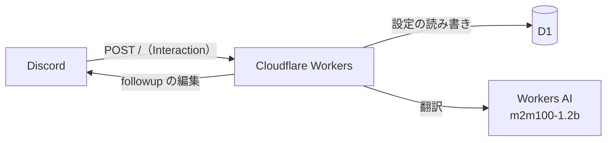
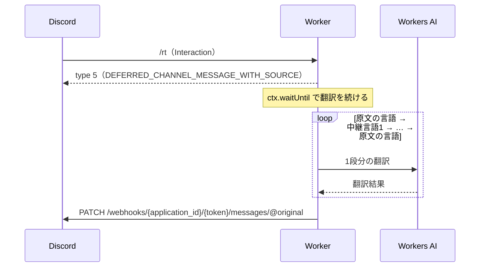

# アーキテクチャと技術選定

この文書は、[リプレース要件](./requirements.md)で定めた機能を「どう作るか」を定める。
実行基盤、言語とフレームワーク、設定の保存先、モジュールの分け方、環境の分け方、コマンド登録の仕組み、開発ツールを扱う。
レート制限、入力の上限、障害時の扱いなどの具体的な値は非機能要件（#27）で決める。

## 全体構成



Worker は Discord から Interaction を HTTP で受け取り、署名を検証してからコマンドごとの処理に振り分ける。
Gateway には接続しないため、常時起動のプロセスを持たない。

## 実行基盤

Cloudflare Workers で確定とする。
翻訳に使う Workers AI を binding で呼べるので、API キーの管理も外部への通信も要らない。
Discord の Interactions は1リクエストで完結する HTTP 呼び出しであり、常時起動のプロセスを必要としない点でも Workers に合う。

プランは無料プランを前提に設計する。
無料プランの CPU 時間の上限は1リクエストあたり10msと小さいが、翻訳と D1 の呼び出しは待ち時間であり CPU 時間に数えられない。
CPU を使う処理は署名検証と JSON の組み立て程度に収まる。
有料にするかどうかと、コストの上限の掛け方は #27 で決める。

## 時間の制約への対処

Discord は Interaction を受け取ってから3秒以内の応答を求める。
`/rt` の翻訳は10段で約10秒かかるため、翻訳を終えてから応答する方式では間に合わない。

そこで `/rt` は次の順で処理する。



1. 署名を検証したら、すぐに type 5（遅延応答）を返す。Discord には「考え中」の表示が出る（#5 の「翻訳中の表示」もこれで満たせる）。
2. `ctx.waitUntil` に渡した処理で、中継ルートの順に翻訳を呼ぶ。
3. 翻訳が終わったら、Interaction のトークンで元の応答メッセージを編集して結果を表示する。

この方式が成り立つのは、時間の上限が次のとおり翻訳の所要時間より長いからである。

| 上限 | 値 | 翻訳（最大約11秒）との関係 |
| --- | --- | --- |
| Discord の初回応答 | 3秒 | 遅延応答を返すだけなので収まる |
| Interaction トークンの有効期限 | 15分 | 十分に余裕がある |
| `waitUntil` の継続時間 | 応答後30秒 | 収まるが、余裕は約3倍にとどまる |

中継言語が10個のとき、翻訳は「原文の言語 → 10言語 → 原文の言語」で11回になる。
余裕が最も小さいのは `waitUntil` の30秒であり、Workers AI の応答が遅くなったときにここを超える可能性がある。
超えた場合の扱い（タイムアウトを設けてエラーを表示するか、段数の上限を下げるか）は #27 で決める。
それでも収まらないと分かった場合は、Queues に処理を移す方式に切り替える[^queues]。

`/settings` と `/help` は D1 の読み書きだけで済むため、遅延応答を使わず type 4 で直接応答する。

[^queues]: Queues の consumer は `waitUntil` より長く実行できる。ただし構成が増えるため、最初からは採らない。利用できるプランの条件は切り替えるときに確認する。

## 言語とフレームワーク

言語は TypeScript 7.0 とし、安定版の版を固定して使う。
7 系はコンパイラを Go で書き直した版で、型検査が速い。
Workers の型定義（`wrangler types` で生成する `Env` など）と、Discord API の型を提供する `discord-api-types` をそのまま使える。

フレームワークは使わず、素の fetch handler で書く。
Discord が呼ぶエンドポイントは1つだけであり、Hono のようなルーターがあっても振り分ける対象がない。
振り分けは Interaction の `type` とコマンド名で行うため、URL のルーティングとは別の層になる。

署名検証は Workers の Web Crypto API（Ed25519）で自前で実装する。
十数行で済み、検証のためだけに依存を増やさずに済む。

## 設定の保存先

D1 を使う。

| 観点 | KV | D1 |
| --- | --- | --- |
| 書き込み直後の読み取り | 他のロケーションへの反映に最大60秒程度かかる | 書き込んだ内容がすぐ読める |
| 無料プランの書き込み上限 | 1日1,000回 | 1日10万行 |
| 無料プランの読み取り上限 | 1日10万回 | 1日500万行 |

KV を採らない理由は、整合性にある。
`/settings relay` で中継言語を変えた直後に `/rt` を呼んだとき、KV では古い中継ルートで翻訳される可能性がある。
設定を変えた本人がすぐ結果を確かめる使い方が自然なので、この遅れは不具合に見える。
無料プランの上限にも、D1 のほうが余裕がある。

D1 が書き込み直後の値を読めるのは、既定ではデータを1か所のプライマリにだけ置き、読み取りも書き込みもそこに送るからである。
この性質を保つため、次の2つを守る。

- 読み取りレプリカ（read replication）は有効にしない。有効にすると読み取りが最寄りのレプリカに送られ、KV と同じく書き込み直後に古い値を読む可能性が出る。
- データベースの作成時に location hint で `apac` を指定する。利用者の多くは日本にいると考えられるので、プライマリをアジア太平洋に置けば問い合わせの往復が短くなる。location hint は作成後に変えられない。

### テーブル

テーブルは1つだけ持ち、マイグレーションの SQL で定義する。

```sql
CREATE TABLE channel_settings (
  channel_id  TEXT PRIMARY KEY,
  origin_lang TEXT NOT NULL,
  relay_langs TEXT NOT NULL CHECK (json_type(relay_langs) = 'array'), -- JSON 配列（例: ["en","fr"]）
  updated_at  INTEGER NOT NULL -- UNIX 時刻（ミリ秒）
);
```

- 行がないチャンネルは未設定とみなし、既定値（中継言語 `en`、原文の言語 `ja`）を使う。読み取りのたびに行を作ることはしない。
- `/settings relay` と `/settings origin` は `INSERT ... ON CONFLICT(channel_id) DO UPDATE` で、指定した列だけを更新する。行がなければ、指定しなかった列には既定値を入れる。
- 中継言語は JSON 配列の文字列で持つ。SQLite には配列型がなく、中継言語は常にまとめて読み書きするため、別テーブルに分けるほどの理由がない。`json_type` の CHECK 制約で、配列でない値は D1 が書き込みを拒む。
- スレッドは親チャンネルと別の `channel_id` を持つため、設定もスレッドごとに独立する。現行も同じ挙動である。

### クエリの型安全

D1 の素の API（`env.DB.prepare(...).first<T>()`）は、型引数 `T` を書いた側の申告をそのまま信じる。
列名を間違えても、型検査では気付けない。

そこで Drizzle ORM を使い、テーブルの定義を TypeScript のスキーマ（`settings/schema.ts`）として書いて、クエリに型を付ける。
スキーマは「テーブル」の節の SQL と同じ定義で書く。

```ts
// src/settings/schema.ts
export const channelSettings = sqliteTable(
  "channel_settings",
  {
    channelId: text("channel_id").primaryKey(),
    originLang: text("origin_lang").notNull(),
    relayLangs: text("relay_langs", { mode: "json" }).$type<string[]>().notNull(),
    updatedAt: integer("updated_at").notNull(),
  },
  (table) => [check("relay_langs_is_array", sql`json_type(${table.relayLangs}) = 'array'`)],
);
```

```ts
const row = await drizzle(env.DB)
  .select({ originLang: channelSettings.originLang, relayLangs: channelSettings.relayLangs })
  .from(channelSettings)
  .where(eq(channelSettings.channelId, channelId))
  .get();
// { originLang: string; relayLangs: string[] } | undefined
```

`relay_langs` は `{ mode: "json" }` を指定しているので、Drizzle が読み出し時に `JSON.parse` し、書き込み時に `JSON.stringify` する。
`store.ts` の外には `string[]` だけを渡す。

#### reylo を採らなかった理由

当初は reylo で `.sql` ファイルのクエリを import し、型検査用のデータベースから型を導く方式を検討した。
雛形のタスク（#30）で reylo 0.8.1 と TypeScript 7.1 の nightly（7.1.0-dev.20261121.1）を組み合わせて検証した結果は、次のとおりである。

| 確かめたこと | 結果 |
| --- | --- |
| `tsc --noEmit --runExternalCode` でクエリに型が付くか | 付いた。存在しない列は型エラーになった |
| wrangler のビルドと `wrangler dev` で `.sql` の import を解決できるか | esbuild と reylo のプラグインで custom build にすれば解決できた |
| Vitest で `.sql` の import を解決できるか | reylo の Vite プラグインを足せば解決できた |
| oxlint の型情報を使うルールが動くか | 動かなかった |

oxlint の型情報を使うルールは `oxlint-tsgolint` が担う。
`oxlint-tsgolint` の最新版（7.0.2008）は TypeScript 7.0.2 のコンパイラを組み込んでおり、7.1 の content mapper を実装していない。
そのため `.sql` の import が `error` 型として扱われ、`no-unsafe-assignment` などのルールが誤検出する。
誤検出を避けるにはクエリを扱うファイルで型情報を使うルールを外すしかなく、型情報を使うルールで検査するという「開発ツール」の方針と両立しない。
この結果を受けて Drizzle を採った。
Drizzle は通常の TypeScript で書けるので、content mapper が要らず、TypeScript も 7.0 の安定版を使える。

### マイグレーション

`migrations/` に SQL を手で書き、`wrangler d1 migrations apply` で適用する。
`drizzle-kit` でスキーマからマイグレーションを生成することはしない。
マイグレーションの SQL を正本とし、`settings/schema.ts` はそれに合わせて手で書く。

スキーマとマイグレーションが食い違っても、型検査では気付けない。
この食い違いは、`settings/store.ts` のテストで見つける。
テストはマイグレーションを適用したローカルの D1 に対してクエリを実行するので、スキーマにあってテーブルにない列を読み書きすると失敗する（[テスト方針](./testing.md)の「単体（ソーシャル）」）。

## モジュールの分け方

```text
src/
  index.ts              fetch handler。署名を検証し、Interaction の type で振り分ける
  verify.ts             Ed25519 の署名検証
  log.ts                構造化ログの出力。記録するイベントとフィールドを型で定める（[ログ設計](./logging.md)）
  result.ts             想定できる失敗を返すための Result 型
  errors.ts             Result の失敗側で使うエラーの種類。log.ts のイベント定義から導く
  commands/
    definitions.ts      コマンドの定義（名前、引数、説明文）。登録スクリプトと共有する
    dispatch.ts         コマンド名（サブコマンドを含む）を Interaction から取り出す
    index.ts            コマンド名ごとのハンドラの一覧
    rt.ts
    settings.ts         show / relay / origin
    help.ts
  translation/
    relay.ts            中継ルートに沿って翻訳を順に呼ぶ
    languages.ts        m2m100 の対応言語一覧と言語コードの検証
  settings/
    schema.ts           Drizzle のスキーマ（migrations/ の SQL と同じ定義）
    store.ts            D1 の読み書き
    route.ts            中継ルートの組み立てと表示用の文字列（例: ja -> en -> ja）
  discord/
    response.ts         Interaction への応答の組み立て
    followup.ts         遅延応答の後に元のメッセージを編集する
scripts/
  register-commands.ts  コマンドの登録
  gen-log-events.ts     src/log.ts から docs/log-events.md を生成する
migrations/
  0001_create_channel_settings.sql
```

依存の向きは `commands/` から `translation/`、`settings/`、`discord/` への一方向とする。
下の層は `commands/` を参照しない。
`log.ts`、`result.ts`、`errors.ts` はどの層からも呼ばれる。`log.ts` と `result.ts` は他のモジュールを import せず、`errors.ts` は `log.ts` の `LogEvent` だけを import する。
この規則は oxlint の `no-restricted-imports` を `overrides` でディレクトリごとに設定して検査する。
レビューで見落とすと逆向きの import が少しずつ増えていくので、CI で機械的に落とす。

Workers の binding（`env.AI`、`env.DB`）は、`translation/relay.ts` と `settings/store.ts` が引数で受け取る。
テストでは binding の代わりに同じ形の偽物を渡せるので、中継ルートの組み立てや言語コードの検証を Workers の実行環境なしで確かめられる。

### エラーの扱い

想定できる失敗（Workers AI の失敗、D1 の失敗、Discord への送信の失敗など）は、throw せずに `Result` で返す。
外部を呼ぶ境界（Workers AI、D1、fetch）で例外を捕まえ、エラーの種類と、例外から取り出した情報（name、code、stack の位置）を持つ自前のデータに変える。
例外のまま上の層へ伝えると、どこで何が起きたかが呼び出し側から見えず、ログに残せる情報も失われるからである。

想定していない例外だけは throw のまま伝え、fetch handler と `waitUntil` に渡す処理の最も外側で捕まえて記録する。
`Result` はライブラリを使わずに自前で定義する。判別できれば足り、合成のためのメソッドは要らないからである。

`Result` の失敗側の型は、各モジュールが定義する。
ログに出す失敗（Workers AI、D1、followup の失敗）は、エラーの種類に `errors.ts` の型を使う。
この型は `log.ts` のイベント定義から導くので、ハンドリングで分ける粒度はログで見分ける粒度と同じになる。
`log.ts` の型からアプリの型を導くのは `errors.ts` だけに限り、`errors.ts` が `log.ts` から import するのも `LogEvent` だけにする。
`errors.ts` から `log.ts` の型を re-export すると、`errors.ts` を中継して `log.ts` のどの型でもアプリ全体に流せてしまうからである。

他のモジュールが `log.ts` から import できるのは、`log()` を呼ぶための入力だけとする。
関数の `log`、`errorDetails`、`interactionPlace` と、型の `Place`、`ErrorDetails` である。
ブランド付きの値（Guild の ID、例外から取り出した stack など）は、`interactionPlace()` が返す `Place` と `errorDetails()` が返す `ErrorDetails` のまとまりでしか手に入らない。
そのため、境目で作った値を下の層の引数で受け取って `log()` に渡すための型名は、この 2 つで足りる。
生の `guild_id` や `channel.id` を渡して下の層で `interactionPlace()` を呼び直す必要はない。

`Place` と `ErrorDetails` は、受け取って `log()` に渡すためだけに使う。
これらを材料にアプリの型を作ること（フィールドを取り出す、交差型や `Pick` で別の型に組み込むなど）はしない。
ログの定義に引きずられる型をあちこちに作ると、ログの都合で変えたイベントの定義がアプリ全体の型を変えてしまうからである。
import できる名前の制限は oxlint の `no-restricted-imports` で検査し、`import()` 型での参照も `consistent-type-imports` で落とす。
import した型をどう使うかは lint では検査できないので、レビューで確かめる。
今の要件では扱いを変えたい失敗と後から見分けたい失敗が一致しているので、粒度が同じでも困らない。
ハンドリングで細かく分けたくなったときは、ログのイベント定義も同じく細かくする。

ログに出さず `Result` で返すだけの失敗（入力の誤りなど）は、各モジュールが自分で型を作ってよい。
`result.ts` の `Result` と `err` には、エラーの種類の型の制約を掛けない。
制約を掛けると、ログに出さない失敗を返すためだけにログの定義へ種類を足すことになるからである。
ログの定義にない種類で作った失敗は、`log()` に渡すときの型検査で見つかる。

## 環境の分け方

開発用と本番の2つの環境を、`wrangler.jsonc` の environments で分ける。

| 項目 | 開発用 | 本番 |
| --- | --- | --- |
| wrangler の指定 | 既定（`--env` なし） | `--env production` |
| Worker 名 | `re-translate-bot-dev` | `re-translate-bot` |
| D1 データベース | `re-translate-bot-dev` | `re-translate-bot` |
| Discord アプリケーション | 以前から使っている開発用アプリ（client ID `982084046924439622`） | 現行のアプリ（client ID `981977773277061210`） |
| Interactions Endpoint URL | 開発用 Worker の `workers.dev` の URL | 本番 Worker の URL |

既定を開発用にするのは、`--env` を付け忘れたときに本番へ配備されないようにするためである。

Worker が実行時に使う値は、アプリケーション ID と公開鍵の2つだけである。
どちらも秘密ではないため `vars` に書く。
followup の編集は Interaction のトークンで認可されるので、bot トークンを Worker に置く必要がない。
bot トークンはコマンドの登録にだけ使い、`.env.development.local` と `.env.production.local`（どちらも git 管理外）に置く。
登録スクリプトは Discord の REST API を呼ぶだけで、Cloudflare 側の操作を含まない。
`.dev.vars` は wrangler が手元で動かす Worker に読み込ませるファイルなので、そこに置くと Worker に bot トークンを置かないという方針と食い違う。
シークレットの管理方針の詳細は #27 で決める。

手元での動作確認は、開発用 Worker を配備して開発用アプリから呼ぶ形で行う。
Discord から呼べる公開 URL が必要なので、`wrangler dev` をトンネルで公開するより配備したほうが手順が少ない。
Workers AI は `wrangler dev` でも Cloudflare 側で実行されるため、手元で動かしても翻訳の費用は変わらない。

## コマンドの登録

`scripts/register-commands.ts` で、`commands/definitions.ts` の定義を Discord に登録する。

- 開発用はギルドコマンド（`PUT /applications/{application_id}/guilds/{guild_id}/commands`）、本番はグローバルコマンド（`PUT /applications/{application_id}/commands`）として一括で上書きする。定義から消したコマンドは Discord 側からも消える。開発用をギルドコマンドにするのは、開発中のコマンドを試すギルドの外に出さないためである。
- 開発用と本番で同じスクリプトを使い、読み込む環境変数のファイルで切り替える。`pnpm run commands:register:dev` は `.env.development.local` を、`pnpm run commands:register` は `.env.production.local` を読む。Node.js は型注釈を取り除いて `.ts` を直接実行できるので、ビルドの手順は要らない。
- 必要な環境変数は `.env.example` に一覧する。`.env.development.local` と `.env.production.local` は、これをコピーして値を入れる。`DISCORD_GUILD_ID` は開発用にだけ書き、書いたときにギルドコマンドとして登録する。
- 実行は手動とし、コマンドの定義を変えたときにだけ走らせる。Worker の配備ごとに登録し直す必要はない。

定義をハンドラと登録スクリプトで共有するのは、登録した引数名とハンドラが読む引数名の食い違いを防ぐためである。

## 開発ツール

| 用途 | 採用 |
| --- | --- |
| パッケージマネージャ | pnpm |
| 型検査 | TypeScript 7.0（`tsc --noEmit`） |
| lint | oxlint（型情報を使うルールは `oxlint-tsgolint`） |
| format | oxfmt |
| テスト | Vitest（`@cloudflare/vitest-plugin`）。何をどこまでテストするかは [テスト方針](./testing.md) で定める |
| CI | GitHub Actions で lint、format の検査、型検査、テストを実行する |

lint と format は oxc のツールで揃える。
`oxlint-tsgolint` は TypeScript 7 系と同じ Go 実装のコンパイラの上で動くため、型情報を使うルールも速く回せる。
oxfmt は 1.0 に達していないので、版を固定し、更新時は差分を確かめてから上げる。

`src/` では、lint を止めるコメント（`oxlint-disable` など）と型検査を止めるコメント（`@ts-ignore`、`@ts-expect-error`、`@ts-nocheck`）を使わない。
止めたくなった箇所はコードを直すか、理由を添えて設定のほうを変える。設定に残せば、例外の範囲がレビューで一か所から見えるからである。
この検査は `git grep` で行い（`pnpm run directives:check`）、`pnpm run lint` に含める。oxlint や ast-grep のルールで検査しないのは、どちらもファイル全体を止めるコメントを持ち、それがそのルールも止めてしまうためである。
テストでは型の誤りを確かめるために `@ts-expect-error` を使うので、`test/` は対象にしない。

テストは `@cloudflare/vitest-plugin` を使い、D1 を含めて Workers の実行環境で動かせるようにする。
`@cloudflare/vitest-plugin` は `@cloudflare/vitest-pool-workers` が改名したもので、旧名のパッケージは更新されない。

プロジェクトの雛形は `pnpm create cloudflare` の hello-world テンプレート（TypeScript）から作り、上の表に合わせて差し替えた。
テンプレートの Prettier の設定（タブ、シングルクォート、1行140文字）は oxfmt に移した。

配備は当面、手元から `pnpm run deploy` で行う。
GitHub Actions からの自動配備は、Cloudflare の API トークンを GitHub に置くことになるため、必要になった時点で検討する。

## 旧コードとの並存

旧コード（`src/` 配下の Python コード、GAS のバックアップ、`Dockerfile`、`compose.yaml`、`run.sh`、`app.json`）は、本番を切り替えた後（#37）に #38 で削除する。
それまでは切り戻せるように旧コードを残すが、新しいコードも `src/` に置くため、同じディレクトリに2つの実装が混ざってしまう。

そこで、雛形を作るタスク（#30）で旧コードを `legacy/` に移す。
EC2 上の bot が既存のチェックアウトから動いていて、配備のたびに pull し直していないなら、移動しても稼働中の bot には影響しない。
移す前に EC2 上の配備手順を確認し、pull して再起動する仕組みがあれば `run.sh` などのパスを合わせて直す。
