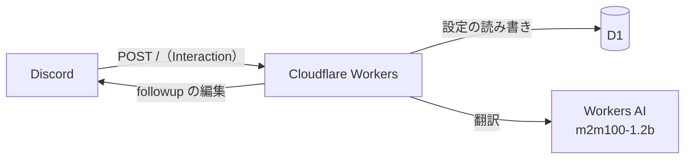
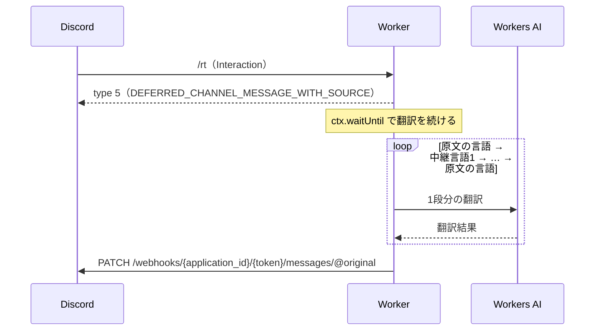

# アーキテクチャと技術選定

この文書は、[リプレース要件](./requirements.md)で定めた機能を「どう作るか」を定める。
実行基盤、言語とフレームワーク、設定の保存先、モジュールの分け方、環境の分け方、コマンド登録の仕組み、開発ツールを扱う。
レート制限、入力の上限、障害時の扱いなどの具体的な値は非機能要件（#27）で決める。

## 全体構成



Worker は Discord から Interaction を HTTP で受け取り、署名を検証してからコマンドごとの処理に振り分ける。
Gateway には接続しないため、常時起動のプロセスを持たない。

## 実行基盤

Cloudflare Workers で確定とする。
翻訳に使う Workers AI を binding で呼べるので、API キーの管理も外部への通信も要らない。
Discord の Interactions は1リクエストで完結する HTTP 呼び出しであり、常時起動のプロセスを必要としない点でも Workers に合う。

プランは無料プランを前提に設計する。
無料プランの CPU 時間の上限は1リクエストあたり10msと小さいが、翻訳と D1 の呼び出しは待ち時間であり CPU 時間に数えられない。
CPU を使う処理は署名検証と JSON の組み立て程度に収まる。
有料にするかどうかと、コストの上限の掛け方は #27 で決める。

## 時間の制約への対処

Discord は Interaction を受け取ってから3秒以内の応答を求める。
`/rt` の翻訳は10段で約10秒かかるため、翻訳を終えてから応答する方式では間に合わない。

そこで `/rt` は次の順で処理する。



1. 署名を検証したら、すぐに type 5（遅延応答）を返す。Discord には「考え中」の表示が出る（#5 の「翻訳中の表示」もこれで満たせる）。
2. `ctx.waitUntil` に渡した処理で、中継ルートの順に翻訳を呼ぶ。
3. 翻訳が終わったら、Interaction のトークンで元の応答メッセージを編集して結果を表示する。

この方式が成り立つのは、時間の上限が次のとおり翻訳の所要時間より長いからである。

| 上限 | 値 | 翻訳（最大約11秒）との関係 |
| --- | --- | --- |
| Discord の初回応答 | 3秒 | 遅延応答を返すだけなので収まる |
| Interaction トークンの有効期限 | 15分 | 十分に余裕がある |
| `waitUntil` の継続時間 | 応答後30秒 | 収まるが、余裕は約3倍にとどまる |

中継言語が10個のとき、翻訳は「原文の言語 → 10言語 → 原文の言語」で11回になる。
余裕が最も小さいのは `waitUntil` の30秒であり、Workers AI の応答が遅くなったときにここを超える可能性がある。
超えた場合の扱い（タイムアウトを設けてエラーを表示するか、段数の上限を下げるか）は #27 で決める。
それでも収まらないと分かった場合は、Queues に処理を移す方式に切り替える[^queues]。

`/settings` と `/help` は D1 の読み書きだけで済むため、遅延応答を使わず type 4 で直接応答する。

[^queues]: Queues の consumer は `waitUntil` より長く実行できる。ただし構成が増えるため、最初からは採らない。利用できるプランの条件は切り替えるときに確認する。

## 言語とフレームワーク

言語は TypeScript 7.1 とする。
7 系はコンパイラを Go で書き直した版で、型検査が速い。
7.1 で入った content mapper を、クエリの型付けに使う reylo が必要とする（「クエリの型安全」を参照）。
7.1 はまだ安定版がなく、reylo は 2026-11-12 以降の nightly を要求するため、nightly の版を固定して使い、安定版が出たら移る。
Workers の型定義（`wrangler types` で生成する `Env` など）と、Discord API の型を提供する `discord-api-types` をそのまま使える。

フレームワークは使わず、素の fetch handler で書く。
Discord が呼ぶエンドポイントは1つだけであり、Hono のようなルーターがあっても振り分ける対象がない。
振り分けは Interaction の `type` とコマンド名で行うため、URL のルーティングとは別の層になる。

署名検証は Workers の Web Crypto API（Ed25519）で自前で実装する。
十数行で済み、検証のためだけに依存を増やさずに済む。

## 設定の保存先

D1 を使う。

| 観点 | KV | D1 |
| --- | --- | --- |
| 書き込み直後の読み取り | 他のロケーションへの反映に最大60秒程度かかる | 書き込んだ内容がすぐ読める |
| 無料プランの書き込み上限 | 1日1,000回 | 1日10万行 |
| 無料プランの読み取り上限 | 1日10万回 | 1日500万行 |

KV を採らない理由は、整合性にある。
`/settings relay` で中継言語を変えた直後に `/rt` を呼んだとき、KV では古い中継ルートで翻訳される可能性がある。
設定を変えた本人がすぐ結果を確かめる使い方が自然なので、この遅れは不具合に見える。
無料プランの上限にも、D1 のほうが余裕がある。

D1 が書き込み直後の値を読めるのは、既定ではデータを1か所のプライマリにだけ置き、読み取りも書き込みもそこに送るからである。
この性質を保つため、次の2つを守る。

- 読み取りレプリカ（read replication）は有効にしない。有効にすると読み取りが最寄りのレプリカに送られ、KV と同じく書き込み直後に古い値を読む可能性が出る。
- データベースの作成時に location hint で `apac` を指定する。利用者の多くは日本にいると考えられるので、プライマリをアジア太平洋に置けば問い合わせの往復が短くなる。location hint は作成後に変えられない。

### テーブル

テーブルは1つだけ持ち、マイグレーションの SQL で定義する。

```sql
CREATE TABLE channel_settings (
  channel_id  TEXT PRIMARY KEY,
  origin_lang TEXT NOT NULL,
  relay_langs TEXT NOT NULL CHECK (json_type(relay_langs) = 'array'), -- JSON 配列（例: ["en","fr"]）
  updated_at  INTEGER NOT NULL -- UNIX 時刻（ミリ秒）
);
```

- 行がないチャンネルは未設定とみなし、既定値（中継言語 `en`、原文の言語 `ja`）を使う。読み取りのたびに行を作ることはしない。
- `/settings relay` と `/settings origin` は `INSERT ... ON CONFLICT(channel_id) DO UPDATE` で、指定した列だけを更新する。行がなければ、指定しなかった列には既定値を入れる。
- 中継言語は JSON 配列の文字列で持つ。SQLite には配列型がなく、中継言語は常にまとめて読み書きするため、別テーブルに分けるほどの理由がない。`json_type` の CHECK 制約で、配列でない値は D1 が書き込みを拒む。
- スレッドは親チャンネルと別の `channel_id` を持つため、設定もスレッドごとに独立する。現行も同じ挙動である。

### クエリの型安全

D1 の素の API（`env.DB.prepare(...).first<T>()`）は、型引数 `T` を書いた側の申告をそのまま信じる。
列名を間違えても、型検査では気付けない。

そこで reylo を使い、`.sql` ファイルに書いたクエリを TypeScript から import して型を付ける。
reylo は TypeScript 7.1 の content mapper の上で動き、型検査のときに型検査用のデータベースファイル（「マイグレーション」を参照）からテーブルの構造を読み取って、クエリの引数と結果の型を導く。
クエリは素の SQL のまま書けて、テーブルの型を手で書く必要がない。

```sql
-- src/settings/queries/get_channel_settings.sql
select origin_lang, relay_langs from channel_settings where channel_id = :channelId
```

```ts
import getChannelSettings from "./queries/get_channel_settings.sql";

const row = await getChannelSettings.run(env.DB, { channelId });
// { origin_lang: string; relay_langs: string } | null
```

`relay_langs` は SQLite では `TEXT` なので、結果の型も `string` になると見込んでいる。
配列への変換（`JSON.parse`）は `settings/store.ts` で行い、`store.ts` の外には `string[]` だけを渡す。

reylo の採用は検証を兼ねる。
reylo は 0.x 系で、前提とする TypeScript 7.1 もまだ安定版がないため、実装の途中で使えなくなる可能性がある。
次のどれかに当たったら、Drizzle ORM に切り替える。

- D1 に対するクエリに、期待どおりの型が付かない。
- Workers 向けのビルド（wrangler）や Vitest（`@cloudflare/vitest-pool-workers`）で `.sql` の import を解決できない。
- 固定した TypeScript 7.1 の nightly で、型検査や oxlint の型情報を使うルールが動かない。

切り替えるときは、Drizzle のスキーマをこの節の SQL と同じ定義で書き、JSON の列は `text("relay_langs", { mode: "json" }).$type<string[]>()` として読み出し時に配列にする。
クエリは3本程度なので、切り替えの影響は `settings/` の中に収まる。
Drizzle にすると content mapper が要らなくなるので、TypeScript も 7.0 の安定版に戻せる。

### マイグレーション

`migrations/` に SQL を手で書き、`wrangler d1 migrations apply` で適用する。

reylo はマイグレーションファイルを読まない。
実際のデータベースに接続し、どんなテーブルと列があるかをデータベース自身に問い合わせて型を作る。
そのため型検査の前に、マイグレーションを適用したデータベースファイル（SQLite）を用意しておき、`DATABASE_URL` で指す。

```text
migrations/*.sql（リポジトリで管理する正本）
      │ マイグレーションを適用する
      ▼
型検査用の SQLite ファイル（git 管理外。毎回作り直す）
      │ reylo がテーブルと列を問い合わせる
      ▼
.sql の import に型が付く
```

- 型検査用のファイルには、テーブルの構造だけがあればよい。データは入れない。
- このファイルはリポジトリに置かず、`.gitignore` に入れる。バイナリなのでレビューで差分を読めず、マイグレーションと内容がずれても気付きにくいからである。毎回マイグレーションから作り直せば、ずれは起きない。
- `wrangler d1 migrations apply --local` も手元にデータベースファイルを作るが、ファイル名を wrangler が決める（`.wrangler/state/` の下にハッシュ値の名前で置かれる）ため、`DATABASE_URL` で指し続けるのに向かない。型検査用のファイルは、決まったパスに別に作る。
- 手元では型検査の前に、CI では型検査のステップの前に、このファイルを作り直す。

具体的な手順は雛形のタスク（#30）で決める。

## モジュールの分け方

```text
src/
  index.ts              fetch handler。署名を検証し、Interaction の type で振り分ける
  verify.ts             Ed25519 の署名検証
  commands/
    definitions.ts      コマンドの定義（名前、引数、説明文）。登録スクリプトと共有する
    dispatch.ts         コマンド名からハンドラを選ぶ
    rt.ts
    settings.ts         show / relay / origin
    help.ts
  translation/
    relay.ts            中継ルートに沿って翻訳を順に呼ぶ
    languages.ts        m2m100 の対応言語一覧と言語コードの検証
  settings/
    queries/            reylo で import する SQL
    store.ts            D1 の読み書き
    route.ts            中継ルートの組み立てと表示用の文字列（例: ja 👉 en 👉 ja）
  discord/
    response.ts         Interaction への応答の組み立て
    followup.ts         遅延応答の後に元のメッセージを編集する
scripts/
  register-commands.ts  コマンドの登録
migrations/
  0001_create_channel_settings.sql
.reylo.yaml
```

依存の向きは `commands/` から `translation/`、`settings/`、`discord/` への一方向とする。
下の層は `commands/` を参照しない。
この規則は oxlint の `no-restricted-imports` を `overrides` でディレクトリごとに設定して検査する。
レビューで見落とすと逆向きの import が少しずつ増えていくので、CI で機械的に落とす。

Workers の binding（`env.AI`、`env.DB`）は、`translation/relay.ts` と `settings/store.ts` が引数で受け取る。
テストでは binding の代わりに同じ形の偽物を渡せるので、中継ルートの組み立てや言語コードの検証を Workers の実行環境なしで確かめられる。

## 環境の分け方

開発用と本番の2つの環境を、`wrangler.jsonc` の environments で分ける。

| 項目 | 開発用 | 本番 |
| --- | --- | --- |
| wrangler の指定 | 既定（`--env` なし） | `--env production` |
| Worker 名 | `re-translate-bot-dev` | `re-translate-bot` |
| D1 データベース | `re-translate-bot-dev` | `re-translate-bot` |
| Discord アプリケーション | 以前から使っている開発用アプリ（client ID は確認中） | 現行のアプリ（client ID `981977773277061210`） |
| Interactions Endpoint URL | 開発用 Worker の `workers.dev` の URL | 本番 Worker の URL |

既定を開発用にするのは、`--env` を付け忘れたときに本番へ配備されないようにするためである。

Worker が実行時に使う値は、アプリケーション ID と公開鍵の2つだけである。
どちらも秘密ではないため `vars` に書く。
followup の編集は Interaction のトークンで認可されるので、bot トークンを Worker に置く必要がない。
bot トークンはコマンドの登録にだけ使い、`.env.development.local` と `.env.production.local`（どちらも git 管理外）に置く。
登録スクリプトは Discord の REST API を呼ぶだけで、Cloudflare 側の操作を含まない。
`.dev.vars` は wrangler が手元で動かす Worker に読み込ませるファイルなので、そこに置くと Worker に bot トークンを置かないという方針と食い違う。
シークレットの管理方針の詳細は #27 で決める。

手元での動作確認は、開発用 Worker を配備して開発用アプリから呼ぶ形で行う。
Discord から呼べる公開 URL が必要なので、`wrangler dev` をトンネルで公開するより配備したほうが手順が少ない。
Workers AI は `wrangler dev` でも Cloudflare 側で実行されるため、手元で動かしても翻訳の費用は変わらない。

## コマンドの登録

`scripts/register-commands.ts` で、`commands/definitions.ts` の定義を Discord に登録する。

- `PUT /applications/{application_id}/commands` で、グローバルコマンドを一括で上書きする。定義から消したコマンドは Discord 側からも消える。
- 開発用と本番で同じスクリプトを使い、読み込む環境変数のファイルで切り替える（例: `node --env-file=.env.development.local scripts/register-commands.ts`）。Node.js は型注釈を取り除いて `.ts` を直接実行できるので、ビルドの手順は要らない。
- 実行は手動とし、コマンドの定義を変えたときにだけ走らせる。Worker の配備ごとに登録し直す必要はない。

定義をハンドラと登録スクリプトで共有するのは、登録した引数名とハンドラが読む引数名の食い違いを防ぐためである。

## 開発ツール

| 用途 | 採用 |
| --- | --- |
| パッケージマネージャ | pnpm |
| 型検査 | TypeScript 7.1 の nightly（`tsc --noEmit --runExternalCode`）。content mapper を動かすため `--runExternalCode` を付ける |
| lint | oxlint（型情報を使うルールは `oxlint-tsgolint`） |
| format | oxfmt |
| テスト | Vitest（`@cloudflare/vitest-pool-workers`）。何をどこまでテストするかは #28 で決める |
| CI | GitHub Actions で lint、format の検査、型検査、テストを実行する |

lint と format は oxc のツールで揃える。
`oxlint-tsgolint` は TypeScript 7 系と同じ Go 実装のコンパイラの上で動くため、型情報を使うルールも速く回せる。
oxfmt は 1.0 に達していないので、版を固定し、更新時は差分を確かめてから上げる。
テストは `@cloudflare/vitest-pool-workers` を使い、D1 を含めて Workers の実行環境で動かせるようにする。

配備は当面、手元から `pnpm run deploy` で行う。
GitHub Actions からの自動配備は、Cloudflare の API トークンを GitHub に置くことになるため、必要になった時点で検討する。

## 旧コードとの並存

旧コード（`src/` 配下の Python コード、GAS のバックアップ、`Dockerfile`、`compose.yaml`、`run.sh`、`app.json`）は、本番を切り替えた後（#37）に #38 で削除する。
それまでは切り戻せるように旧コードを残すが、新しいコードも `src/` に置くため、同じディレクトリに2つの実装が混ざってしまう。

そこで、雛形を作るタスク（#30）で旧コードを `legacy/` に移す。
EC2 上の bot が既存のチェックアウトから動いていて、配備のたびに pull し直していないなら、移動しても稼働中の bot には影響しない。
移す前に EC2 上の配備手順を確認し、pull して再起動する仕組みがあれば `run.sh` などのパスを合わせて直す。
