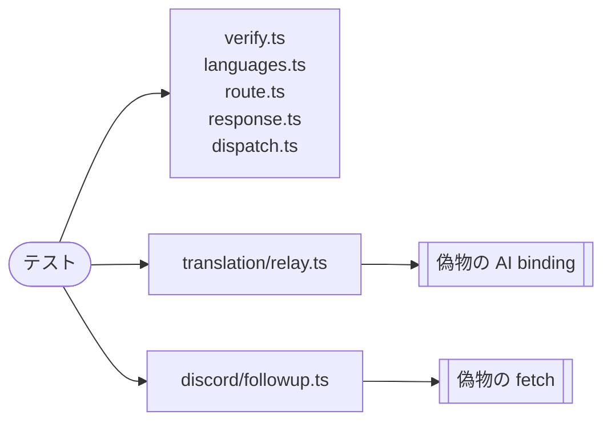
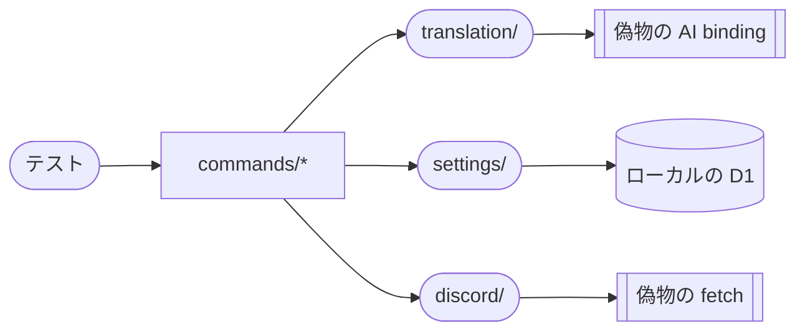
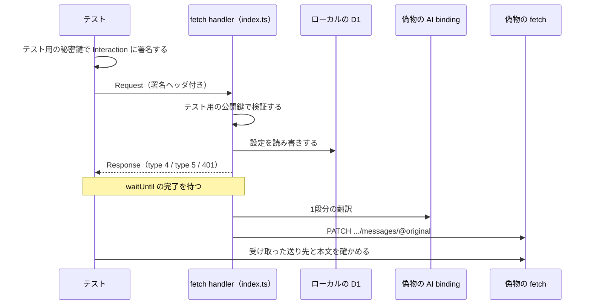

# テスト方針

この文書は[アーキテクチャ](./architecture.md)で定めたモジュールを、どのレベルのテストで、何を差し替えて確かめるかを定める。
個々のテストケースは各実装タスクでこの方針に沿って決める。

## 実行環境

すべてのテストを Vitest と `@cloudflare/vitest-plugin` で、Workers の実行環境（workerd）の上で動かす。
署名検証は Web Crypto の Ed25519 を、設定の保存は D1 を使うため、Node.js で動かすと本番と違う API の上で確かめることになる。
外部との境界を持たない純粋なモジュールも同じ環境で動かし、実行環境を1つに揃える。

## レベルと範囲

テストは次の3つのレベルに分ける。
ある振る舞いは、それを確かめられる最も低いレベルで確かめる。
上のレベルでは下のレベルで確かめた分岐を繰り返さない。

| レベル | 対象 | 確かめること |
| --- | --- | --- |
| 単体（単独） | 下位の層の1モジュール | そのモジュールの入出力と分岐 |
| 単体（ソーシャル） | `commands/` のハンドラと `settings/store.ts` | 下位のモジュールを本物で組み合わせたときの振る舞いと、D1 の読み書き |
| 結合 | `index.ts` の fetch handler | Discord との取り決め（署名の検証、応答の type、followup の送り先と形） |

図ではテストの対象を四角の箱、本物のまま使う依存を角丸の箱と円柱、偽物に差し替える依存を二重線の箱で表す。

### 単体（単独）

外部との境界を持たないモジュールは、何も差し替えずに呼ぶ。
`relay.ts` は AI binding を引数で受け取るので、同じ形の偽物を渡す。
`followup.ts` は Discord API を fetch で呼ぶので、外向きの fetch を差し替える。

### 単体（ソーシャル）

ハンドラが呼ぶ下位のモジュールは本物を使い、Workers AI と Discord API だけを偽物にする。
D1 は差し替えず、`@cloudflare/vitest-plugin` が用意するローカルの D1 にマイグレーションを適用して使う。
SQL とスキーマの食い違いは偽物では見つからないので、`settings/store.ts` も単独ではなくこのレベルで確かめる。

### 結合

テストは Discord の代わりに署名付きの Request を作り、Worker の fetch handler に渡す。
`/rt` の followup は `waitUntil` の中で送られるので、`@cloudflare/vitest-plugin` の実行コンテキストを渡し、その完了を待ってから偽物の fetch が受け取った内容を確かめる。

## 依存の差し替え

| 依存 | 単独 | ソーシャル | 結合 | 差し替え方 |
| --- | --- | --- | --- | --- |
| 下位のモジュール | 使わない | 本物 | 本物 | なし |
| D1 | 使わない | ローカル | ローカル | マイグレーションを適用したローカルの D1。テストごとに分離する |
| Workers AI | 偽物 | 偽物 | 偽物 | 引数で偽物を渡す。結合ではテスト用の設定で `env.AI` を偽物にする |
| Discord API | 偽物 | 偽物 | 偽物 | 外向きの fetch を差し替える |
| 署名の鍵 | テスト用 | なし | テスト用 | テストの準備で Ed25519 の鍵ペアを作り、公開鍵をテスト用の `vars` に入れる |

差し替えの基準は「ローカルで再現できるかどうか」にある。
D1 はローカルで本物と同じ SQLite が動くので本物を使う。
Workers AI はローカルで動かず、呼べば無料枠を使うので偽物にする。

Workers AI の偽物が返す結果とエラーの形は、実物の応答を観測して決める。
偽物が実物とずれていると、テストが通っても本番で失敗する。
ずれがないことはテストでは確かめられないため、人が確かめる（「自動テストしない範囲」を参照）。

### Interaction のデータ

テストで使う Interaction は、`discord-api-types` の型を返す組み立て用の関数で作る。
関数は必須の項目を既定値で埋め、テストは確かめたい項目だけを指定する。
JSON の fixture を置かないのは、型の更新で項目が変わったときに fixture では型検査で気付けないからである。

署名はこの関数で作った本文に対して付ける。
不正な署名は正しく署名した後に署名、本文、タイムスタンプのいずれかを書き換えて作る。

## カバレッジ

カバレッジは istanbul で測る（`@cloudflare/vitest-plugin` は V8 のカバレッジに対応していない）。
全レベルのテストを1回の実行で合わせて測り、各レベルの対象ごとに目標を置く。

| レベル | 範囲 | 目標 |
| --- | --- | --- |
| 単体（単独） | `verify.ts`、`translation/`、`settings/route.ts`、`discord/` | 分岐 90% 以上 |
| 単体（ソーシャル） | `settings/store.ts` | 分岐 90% 以上 |
| 単体（ソーシャル） | `commands/`（`definitions.ts` を除く） | 測るが閾値は置かない |
| 結合 | `index.ts` | 測るが閾値は置かない |
| 自動テストしない範囲 | `commands/definitions.ts`、`scripts/` | 測らない |

目標を置いた範囲は、下回ったら CI で落とす。

目標を下位の層に置くのは、分岐の多くがそこにあり、モジュールを直接呼ぶテストで安く網羅できるからである。
`commands/` と `index.ts` の分岐は下位の層の組み合わせで決まるので、ここで網羅を求めると、下位の層で確かめた分岐を何度も確かめることになる。
コマンドの定義と登録スクリプトは Discord に登録して初めて意味を持つので、実機で確かめる。

## CI

プルリクエストで次のすべてを必須のチェックにする。

- lint（oxlint）
- format の検査（oxfmt）
- 型検査（tsc。`wrangler types` で生成した型が `wrangler.jsonc` と一致しているかも確かめる）
- テスト（カバレッジの閾値を含む）

実装タスクの完了条件は、この方針で定めたテストが揃い、これらがすべて通ることとする。

## 自動テストしない範囲

次の範囲は自動テストを書かず、開発用 Worker と開発用アプリで人が確かめる。
Discord の表示と Workers AI の実物は、テストの実行環境で再現できないためである。
本番に配備する前と、応答の見た目やコマンドの定義を変えたときに行う。

- Workers AI の実物の応答とエラー（無料枠の使い切りを含む）の形が、偽物と一致しているか
- コマンドの登録が反映され、引数と説明文が意図どおりに表示されるか
- 各応答の見た目（スポイラー、中継ルートの表示、絵文字、改行）が崩れていないか
- `/rt` で「考え中」の表示が出て、中継言語10個でも30秒以内に結果かエラーに置き換わるか
- 本文の `@everyone` などで通知が飛ばないか
- 権限と intent を外した状態で招待し、すべてのコマンドが動くか
